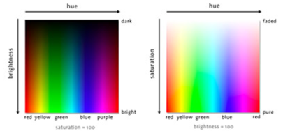

# Bug hunt camouflage (NetLogo)

## Background

Adaptive evolution via natural selection is a fundamental concept in evolutionary biology and is one of the central mechanisms driving the diversity of life on Earth. This process is shaped by the interplay between variation in heritable traits within a population, differential survival and reproduction rates, and the environmental challenges faced by organisms. One illustrative example of natural selection is the phenomenon of camouflage in predator-prey systems. 

In an environment where predators rely on visual cues to locate their prey, individuals with better camouflage that matches their surroundings are more likely to avoid detection and capture, leading to higher survival rates. Over generations, the frequency of camouflage traits increases in the prey population due to higher survival and increased reproduction of well-camouflaged individuals. 

On the other hand, predators with better detection skills, like keen eyesight, are more successful at capturing prey, leading to increased survival and reproduction of these individuals. Consequently, traits associated with effective predation also become more prevalent in the predator population. This dynamic interplay between camouflage in prey and predator detection abilities exemplifies the power of natural selection in driving the adaptation and evolution of species to their ecological niches.

## Learning outcomes

::: {.do-something}
Learning outcomes:

- Understand adaptive evolution via natural selection.
- Identify the four conditions for evolution by natural selection in a model.
- Explain how fitness depends on the environment.
- Use the terms adaptation, selection, selection pressure, and heritability correctly.

:::

## Your task

In this exercise, you will use an individual-based simulation to examine adaptive evolution and natural selection, exploring how living organisms can undergo transformations to better survive and thrive in their environments. You step into the role of a predatory bird and hunt bugs living in a virtual landscape. You will see how the colours of the bugs ("traits") influence their survival. The bugs that blend into their surroundings have a higher chance of avoiding detection, leading to greater survival and more opportunities to pass on their advantageous traits to future generations.

The exercise is done using one of the built-in models in a computer program called NetLogo (https://ccl.northwestern.edu/netlogo/).

There are two ways to use NetLogo: (1) You can log in to our SDU UCloud computing system at https://cloud.sdu.dk/, and use it there; (2) You can download and install NetLogo from the site above.

I recommend the UCloud option: Please follow these steps: (i) search for NetLogo in the search bar at the top of the screen; (ii) click on Applications and then on the NetLogo icon; (iii) click on "Run Application"; (iv) Give your job a name (e.g., "BB512") and under "Hours" enter 1 hour; (v) under Machine Type, select "u1-standard-1"; (vi) click on Submit. After a few moments while UCloud is preparing your job, a new screen appears. Click on Open Interface to open a virtual desktop. There, you can open NetLogo and use it as if it was on your own computer by clicking on its icon.

Open NetLogo and click File > Models Library. You can then use the search box at the bottom of the screen to find the model called “Bug Hunt Camouflage”.

This is a model of natural/artificial selection that shows how a population hunted by a predator can develop camouflaging. For example, in a forest with green leaves, green bugs may emerge as the predominant bug colour.

In the simulation you assume the role of a predatory bird that feeds on insects, which can be different colours.  You will see what effect your hunting has on the colour traits/genetics of these simulated insects, and also how this evolution affects your hunting efficiency.


### How the simulation works

Read this before you start, so that you know what the model does (and does not) include.

The simulation starts with bugs of random colours. Each bug has three pigment "genes" (red, green and blue) that together set its colour (see "Details about colours" at the end).

The model makes these assumptions:

- **Constant population size.** Each time you catch a bug, one of the surviving bugs is chosen at random to produce one offspring, so the number of bugs stays at the carrying capacity.
- **Asexual reproduction.** An offspring has a single parent and inherits its colour genes.
- **Small mutations.** Each of the offspring's three colour genes can differ slightly from the parent's. The "max-mutation-step" slider controls how big these differences can be.
- **Offspring appear near their parent**, within the distance set by the "offspring-distance" slider.
- **Newborn bugs start very small** and grow to full size over time.
- **Bugs do not move**, and the predator (you) is the only cause of death.

So if you consistently catch (e.g.) non-reddish bugs, the reddish bugs that remain will have offspring that are also reddish, and the average colour of the population will shift towards red.

In the lecture, evolution was defined as: "*change in the heritable characteristics [colour traits] of biological populations [bugs] over successive generations [time].*"

### Predict first

Before you run the model, write down your predictions:

1. What will happen to the average colour of the bugs after you have hunted for two minutes on one background?
2. What will happen to the time it takes you to catch 10 bugs?
3. What will happen when you then switch to a different background?

You will check these predictions against what you observe.

### Getting started

1. When you open the model, you will see a screen with various purple and green "sliders", buttons and menus that control parts of the model.
2. Start with 30 bugs, by moving the "carrying-capacity" slider until it reads 30.
3. Now click "setup". You should see the environment appear on the right hand side, and you should see a few "bugs" on the environment. Start the simulation by clicking "go".
4. After you click go, you need to click on bugs as fast as you can using your mouse/track pad. You can also keep the mouse button depressed, and move the cursor around the world to catch the bugs. Try to consume bugs as fast as possible to remove any "deliberation" on your part as a predator. The camouflaging effect will emerge more clearly if you aren't taking your time trying to find bugs that typically would be more difficult to find.

You can track your progress by looking at the graphs on the left. The most useful are (1) the number of bugs caught through time, (2) the time taken to catch each batch of 10 bugs, and (3) the average colour values of the bugs.

In the "Bugs Caught vs. Time" plot the slope of the curve gives a good idea of your hunting efficiency: the faster you can catch bugs, the steeper the slope. If you didn't catch any bugs for a while, the slope would be horizontal.

You should notice that bugs with contrasting colours (e.g. black on white) are easier to catch. Keep hunting for 2 minutes, then pause the simulation by clicking "go" again. Now take a look at the graphs and see what effect your hunting has had on the colours in the population.

### Measure your hunting efficiency

Use the "Time to catch 10 bugs" plot to put numbers on your hunting efficiency. Record:

| | Time to catch 10 bugs |
|---|---|
| First 10 bugs | |
| Last 10 bugs before you switch background | |
| First 10 bugs after you switch background | |
| Last 10 bugs on the new background | |

Compare your numbers with your neighbour's. They will differ (you are different predators!), but is the pattern the same?

Your catch time does not depend only on the bugs. Apart from bug evolution, what else could change how long it takes you to catch 10 bugs? Which of the plots gives more direct evidence that the bugs themselves have evolved?

## Questions

Answer the following questions, then make sure you confirm your understanding and have the right answers with an instructor.

*	What happens to the average colour of the bug population with time as you hunt? Was your prediction correct?
*	What happens to your hunting efficiency? Use your measurements.
*	Would you say that the bug population becomes worse or better adapted to their environment?
*	Can you explain how this happens?
*	After simulating in one environment (e.g. poppy field) for a few minutes, pause then switch to another environment. Are the bugs now well- or poorly-adapted to their environment?
*	Do the genotypes of individuals change (e.g. with individual age)? Switch on "show-genotype?" and watch a few individual bugs for 30 seconds to find out.
*	Increasing the "max-mutation-step" makes bug offspring less like their parents. How do you think this will influence the speed of adaptation of the bugs?
*	In the lecture we met four conditions for evolution by natural selection: (1) individuals vary in a trait, (2) individuals vary in reproductive success, (3) the trait affects reproductive success, and (4) the trait is inherited. Where do you see each of these in the model? Where does new variation come from?
*	Newborn bugs start very small. Could this let some bugs escape for reasons that have nothing to do with their colour? How might that affect the results?
*	How does this model differ from a real predator–prey system? Give at least two differences.

Some useful keywords:

*	Selection
*	Adaptation
*	Selection pressure
*	Heritability (how much of the variation in a trait among individuals is passed on from parents to offspring; you will meet a more precise definition in Part 3)

::: {.do-something}
**Optional extension: gene flow and local adaptation**

In the lecture we saw that gene flow can swamp local adaptation. You can explore this with the "offspring-distance" slider, which sets how far from its parent an offspring can appear.

1. Choose the background with the most distinct patches of different colour.
2. Set "offspring-distance" to a small value and hunt for a few minutes. Use "flash" or "clear-background" to see where the bugs are. Do bugs in different patches come to match their own patch?
3. Repeat with a large "offspring-distance". What happens now, and why?

:::

## Details about colours (optional) 

Each bug has three pigment genes: red, green and blue. Each gene has a value from 0 to 100, which sets how strongly that pigment is expressed. Switch on "show-genotype?" to see each bug's values; for example, 40-100-24 means red at 40%, green at 100% and blue at 24%. The three pigments are mixed, as in the pixels of a TV or computer screen, to give the bug's colour. A bug with a lot of red but little green or blue looks red.

The plots summarise colour in a different way, as **hue**, **saturation** and **brightness** (Fig \@ref(fig:colours)):

- **Hue** is the position around the colour wheel: red, through orange, yellow, green and blue, and back to red.
- **Saturation** is how vivid the colour is. Low saturation gives washed-out colours (greys, and white at full brightness).
- **Brightness** is how light or dark the colour is. A brightness of 0 is black, whatever the hue.

```{r colours, out.width = "65%", fig.align = 'center', echo = FALSE, fig.cap = "Hue, brightness and saturation"}

```

If this figure does not display in your browser, open it directly here: [Hue, brightness and saturation diagram](images/colours.png).

Read more about the model here: http://ccl.northwestern.edu/netlogo/models/BugHuntCamouflage

## Takeaways

- Selection changes trait distributions when survival depends on the environment.
- All four conditions for evolution by natural selection are present in the model; mutation supplies the new variation.
- Adaptation is context-dependent: a well-adapted population can become poorly adapted when conditions change.
- Heritability and mutation govern how quickly populations can respond to selection pressure.
