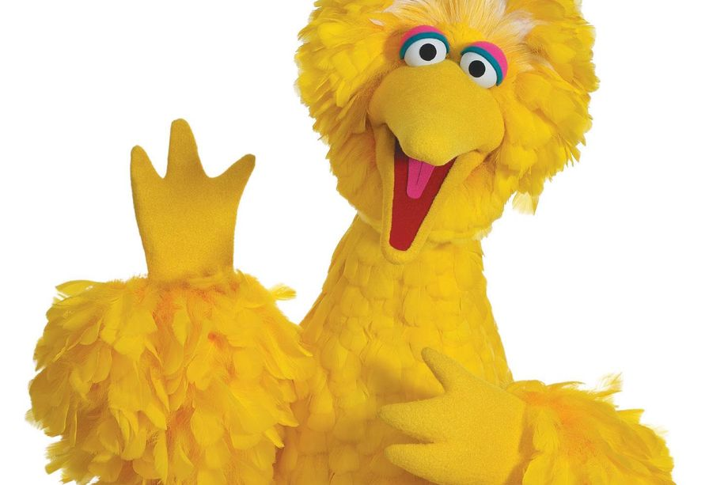

# How many eggs should a bird lay?

## Background

Trade-offs are inherent compromises in biology, where allocating limited resources to one trait may come at the expense of another. Organisms face these trade-offs when making crucial life-history decisions. One classic example is the British ornithologist David Lack's clutch size trade-off. Parents can feed only so many chicks, so the more eggs a bird lays, the less food each chick gets and the lower its chance of surviving. Lack proposed that clutch size evolves to the number from which, on average, the most young survive. In other words, although it may be beneficial to have many offspring, the survival of those offspring will decline if they cannot be cared for.

Understanding such trade-offs sheds light on the fascinating strategies that organisms employ to optimise their fitness and evolutionary success. Further reading: Neal's chapter *Evolution of Life Histories*.


::: {.do-something}
Learning outcomes: 

- Calculate the expected number of surviving offspring from clutch size and chick survival.
- Explain how a trade-off between offspring number and offspring survival produces an intermediate optimum.
- Predict how the optimum changes when the environment, or the cost of breeding to the parents, changes.

:::

## Before you start: predict

Before you calculate anything, make a prediction and write it down: will a big bird that lays **10 eggs** raise more surviving chicks than one that lays **4 eggs**, or fewer? Why? You will check your prediction below.


## Your task

The big bird (*Bigus canarius*) (Fig  \@ref(fig:bigbird)) can lay up to 10 eggs per breeding season. If there is only 1 egg, the probability that the parents can adequately feed the chick and ensure it survives is very high (0.9). However, as the number of siblings increases, the amount of energy and food that the parents can dedicate to caring for *each* chick decreases, and the probability of survival therefore declines . With a clutch size of 10 eggs, there is so little food *per chick* that the survival rates are close to zero.

```{r bigbird, out.width = "50%", fig.align = 'center', echo = FALSE, fig.cap = "Big bird, *Bigus canarius*"}

```

A recent study gathered data on chick survival probability as a function of number of eggs in the nest. These are given in the table below. 

| Eggs | Survival probability |
|------|-----------------------|
| 1    | 0.90                  |
| 2    | 0.85                  |
| 3    | 0.82                  |
| 4    | 0.70                  |
| 5    | 0.50                  |
| 6    | 0.30                  |
| 7    | 0.22                  |
| 8    | 0.15                  |
| 9    | 0.10                  |
| 10   | 0.05                  |

Use these data to plot a graph in Excel with number of eggs on the x-axis and survival probability on the y-axis.

Now, in another column in Excel, calculate, given the chick survival probability, what the expected number of surviving chicks will be for a big bird laying between 1 and 10 eggs^[This may require some thought!].

Plot your result on another graph with number of eggs on the x-axis and number of surviving offspring on the y-axis.

What do you notice? What is the optimum number of eggs to lay? 

Advanced: What happens to the optimum as you change the relationship between clutch size and survival?

Field observations of the big bird show that most females lay **3 eggs**. Keep this in mind for the questions below.

## Assumptions

This simple model assumes that every egg hatches, that every chick in a nest has the same chance of surviving, that we count only one breeding season, and that laying and raising more eggs has no cost to the parents' own survival. Question 3 relaxes the last assumption.


## Questions

1. What is Lack's hypothesis? Does the big bird's optimum support it, given that most big birds lay 3 eggs?
2. In a good food year, each chick's survival probability in clutches of 5 or more eggs is 0.2 higher (for example, 0.50 becomes 0.70). Recalculate. What is the best clutch size now, and why?
3. Raising chicks is costly for the parents. Suppose the probability that a parent survives to breed again next year is $0.8 - 0.08 \times \text{eggs}$ (so 0.72 with 1 egg, and 0.48 with 4 eggs). On average, a parent then breeds $1 / (1 - \text{parent survival})$ times in its life. Calculate the number of surviving chicks over a parent's whole life for each clutch size. Does the best clutch size change? What does this mean for Lack's hypothesis?
4. (Discussion) Birds also trade off the number of eggs against the size of each egg. What would you need to add to this model to study that trade-off?

## Takeaways

- Trade-offs often produce intermediate optimal strategies.
- Expected reproductive success depends on both offspring number and survival probability.
- If raising young costs the parents' future survival, the best clutch is smaller than the one that produces the most surviving young in a single season.
