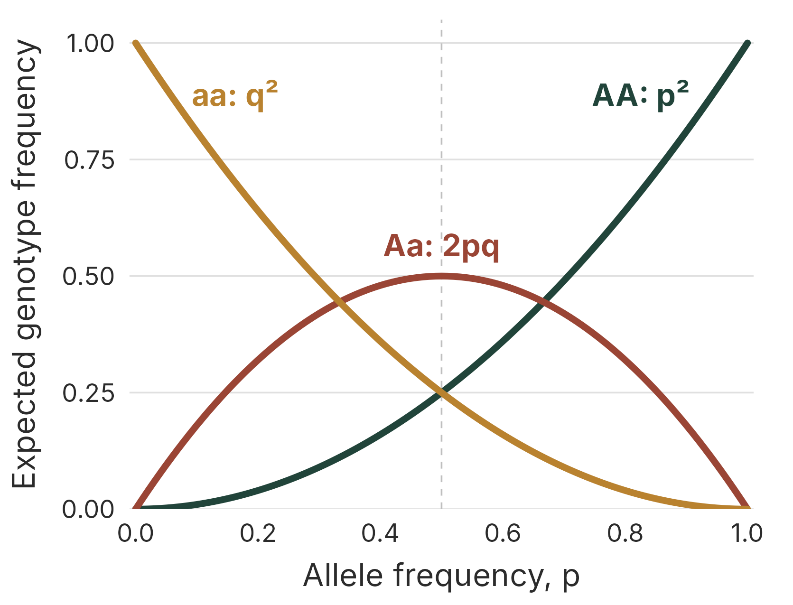

# Hardy-Weinberg equilibrium

::: {.do-something}
Learning outcomes. By the end of this practical you should be able to:

- Explain the difference between alleles and genotypes.
- Calculate expected genotype frequencies from allele frequencies, and allele frequencies from the frequency of a recessive genotype.
- Estimate allele frequencies from observed genotype counts and compare the observed counts with those expected under Hardy-Weinberg equilibrium (HWE).
- List the assumptions of HWE and explain what a departure from HWE might, and might not, tell you.

:::

## Background

Hardy-Weinberg equilibrium is a fundamental concept in population genetics for understanding the genetic dynamics of populations. Named after British mathematician G.H. Hardy and German physician Wilhelm Weinberg, this principle describes the stable genetic proportions in a population under specific conditions of no evolution.

In an idealised population, where mating is random, genetic mutations are absent, natural selection is not acting, and there is no gene flow or genetic drift, the frequencies of alleles and genotypes remain constant across generations.

The Hardy-Weinberg equilibrium provides a baseline against which real populations can be compared, allowing researchers to detect factors that may cause deviations from this equilibrium and, in turn, understand the forces driving evolution and genetic changes within populations.

In this practical we will learn more about HWE and practise solving some HWE-related problems.


The key formulae of the Hardy-Weinberg Equilibrium are:

Equation 1: $p + q = 1$

and

Equation 2: $p^2 + 2pq + q^2 = 1$.

Let's first consider where these equations come from. First, Equation 1.

In a diploid organism, each individual carries two alleles for a particular gene. Let's consider a gene with two alleles, A and a. In a given population:

$p$ is the frequency of allele A (in these problems, the dominant allele)
$q$ is the frequency of allele a (the recessive allele)

The sum of the frequencies of these two alleles in the population must equal 1, as they are the only two possibilities for this gene, so $p+q=1$.

Note that dominance affects the *phenotype*, not the allele frequency. A dominant allele can be rare and a recessive allele can be common.

Equation 1 serves as the foundational stepping stone for Equation 2. In Equation 1, we establish the sum of allele frequencies, $p$ and $q$, in the gene pool. This equation sets the stage for the more complex Equation 2, where we translate these allele frequencies into genotype frequencies for the population.

We can derive Equation 2 based on the gene pool and random mating. Let's consider a mating event between two random alleles. The possible combinations of alleles are:

$p \times p = p^2$ (AA)
$q \times q = q^2$ (aa)
$p \times q = pq$ (Aa)
$q \times p = pq$ (aA)

Notice that we have two $pq$ terms (Aa and aA). The order of alleles doesn't matter, so they are summed together: $2pq$.

So, the total probability for all possible combinations is:

$p^2 + 2pq + q^2$.

This must equal 1 (100% probability), which gives us Equation 2:

$p^2 + 2pq + q^2 = 1$.

In these formulae, $p^2$ is the frequency of the homozygous AA genotype, $q^2$ is the frequency of the homozygous aa genotype and $2pq$ is the frequency of the heterozygous Aa genotype. From these equations we can produce the following plot, which shows the expected genotype frequencies at HWE for any allele frequency. HWE can occur at any allele frequency, but once the allele frequency is known, the expected genotype frequencies are fixed by Equation 2. (It is a common misconception that the three genotypes should occur in a 1:2:1 ratio, or that allele frequencies should tend towards 50% $p$ and 50% $q$.)

Given a small amount of information it is possible to figure out what the allele and genotype frequencies should be *if the population is at HWE*.

If a population is NOT at HWE, that is a signal worth investigating. It may mean that one of the assumptions below is violated, but apparent departures can also arise from genotyping errors or simple chance in a small sample.

```{r hardyweinberg, echo = FALSE, out.width = "70%", fig.cap = "The Hardy-Weinberg Equilibrium. The lines show the expected genotype frequencies at HWE for each allele frequency, p."}

```

## Assumptions of Hardy-Weinberg Equilibrium

For a population to be in Hardy-Weinberg Equilibrium, certain assumptions must be met:

- Random mating: There is no preference in mate selection based on genotype.
- No mutations: The gene pool is stable with no new alleles being added.
- Large population size: To negate the effects of genetic drift.
- No gene flow: No new individuals enter or leave the population.
- No natural selection: All genotypes in the population have an equal chance of reproductive success.

These assumptions do two different jobs. Random mating is what produces the Hardy-Weinberg genotype proportions ($p^2 : 2pq : q^2$) in each generation. The other four (no mutation, no drift, no gene flow and no selection) are what keep the allele frequencies themselves constant from one generation to the next.

Any deviation from these assumptions could result in a population that is not in Hardy-Weinberg Equilibrium.

## Worked example

Unless a problem states otherwise, assume that the population is at HWE. This matters: working back from the frequency of a recessive genotype to an allele frequency (as below) is only valid if the population is at HWE.

### Inputs

- Recessive genotype frequency: $q^2 = 0.16$

### Steps

1. Calculate $q = \sqrt{0.16} = 0.4$.
2. Calculate $p = 1 - q = 0.6$.
3. Calculate heterozygote frequency: $2pq$.

### Output and interpretation

$2pq = 2(0.6)(0.4) = 0.48$. So 48% of individuals are expected to be heterozygous under HWE assumptions.

## Your task

Tackle the following problems, using the HWE theory outlined above. Worked solutions are given in Section \@ref(solutions-hardy-weinberg-equilibrium).

### Problem #1.

A population has two alleles, A and a, at a gene of interest. The frequency of allele A is 0.7. Assuming the population is at HWE, calculate the following:

*	The frequency of allele a.
*	The expected frequencies of the genotypes AA, Aa and aa.
*	The frequencies of the two possible phenotypes if A is completely dominant over a.

### Problem #2.

Sickle-cell disease is an interesting genetic disease caused by a variant of the haemoglobin gene. People with two copies of the usual allele (HbA/HbA) have normal red blood cells, which the malaria parasite infects readily, so many become severely ill with malaria. People with two copies of the sickle-cell allele (HbS/HbS) have sickle-cell disease: their red blood cells readily collapse into a rigid sickle shape when deoxygenated, causing serious illness. Heterozygous people (HbA/HbS), who are said to have sickle-cell *trait*, have only mild sickling, which is rarely harmful, and they have increased resistance to severe malaria. In regions where malaria is common, heterozygotes therefore tend to survive better than either homozygote.

*	In a population from a malaria-endemic region, 9% of babies are born with sickle-cell disease (HbS/HbS). Assuming the population is at HWE at birth, what percentage of babies will be heterozygous (HbA/HbS), and so more resistant to severe malaria?

Because of the survival differences described above, genotype frequencies among *adults* in such a population are not expected to stay at HWE. This is why the question asks about babies at birth.

### Problem #3.

You genotype a sample of 200 individuals from a population at a gene with two alleles, A and a. You find 120 AA, 40 Aa and 40 aa individuals. This time, do NOT assume the population is at HWE: the aim is to test it.

*	Calculate the frequencies of alleles A and a from the genotype counts. (Hint: 200 diploid individuals carry 400 allele copies, and each heterozygote carries one copy of each allele.)
*	Calculate the expected number of each genotype if the population were at HWE.
*	Compare the observed and expected counts. Is there an excess or a deficit of heterozygotes? Suggest some reasons why a population might show this pattern.


### Problem #4.

Within a population of butterflies, the colour brown (B) is dominant over the colour white (b). And, 40% of all butterflies are white. Given this simple information calculate the following:

*	The percentage of butterflies in the population that are heterozygous.
*	The frequency of homozygous dominant individuals.
*	*Extension:* Of the brown butterflies, what proportion would you expect to be heterozygous? (Think carefully about what the denominator should be.)

## Takeaways

- Hardy-Weinberg equilibrium provides a baseline for detecting evolutionary forces.
- Allele frequencies ($p$, $q$) determine genotype frequencies ($p^2$, $2pq$, $q^2$).
- Comparing observed genotype counts with HWE expectations can reveal a departure from HWE. A departure identifies a pattern worth investigating (for example, a violated assumption, genotyping error or chance in a small sample), not its cause.
