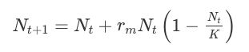

--- 
title: "BB512 - Population Biology and Evolution"
author: "Owen R. Jones (Course Coordinator)"
date: "`r Sys.Date()`"
site: bookdown::bookdown_site
pandoc_args: --listings
always_allow_html: true
output:
  bookdown::gitbook:
    config:
      toc:
        collapse: section
    includes:
      in_header: extras.css
  bookdown::pdf_book:
    includes:
      in_header: preamble.tex
    papersize: a4
  pdf_document:
    includes:
      in_header: preamble.tex
classoption: a4paper
documentclass: book
bibliography: [book.bib, packages.bib]
biblio-style: apalike
link-citations: yes
description: "Course book for BB512 at the Biology Department, University of Southern Denmark"

---

```{r setOptions, include = FALSE}
knitr::opts_chunk$set(
  warning = FALSE, message = FALSE
)
library(dplyr)
library(flextable)
library(officer)

# Global seed for reproducible random outputs
set.seed(123)
```

```{r course-config, include = FALSE}
course_year <- format(Sys.Date(), "%Y")
exam_month <- "January"
exam_note <- "finalised in December"

instructors <- data.frame(
  name = c("Owen Jones", "Thomas Bjørneboe Berg"),
  url = c(
    "https://portal.findresearcher.sdu.dk/en/persons/jones",
    "https://portal.findresearcher.sdu.dk/en/persons/thomasbb"
  ),
  title = c("Associate Professor", "Associate Prof./Senior Scientist at Naturama"),
  email = c("jones@biology.sdu.dk", "thomas@naturama.dk"),
  stringsAsFactors = FALSE
)
```

# Welcome to BB512


Welcome to the Population and Evolution course. 
The course is divided into five teaching parts:

1. Evolution by Natural Selection
2. Population Growth Models
3. Population Genetics and Evolution
4. Interactions Between Species and Community Structure
5. Animal Behaviour, Altruism and Sexual Selection

The recommended textbook is Neal (2019). Other useful textbooks, that are NOT mandatory, but could be useful are Gotelli (2008) and Stearns & Hoekstra (2005).


* Neal, D. (2019). *Introduction to Population Biology* (2nd edition). Cambridge: Cambridge University Press. <https://doi.org/10.1017/9781139107976>
* Gotelli, NJ (2008) *A Primer of Ecology*. Fourth Edition, Sinauer Associates. ISBN: 978-0878933181
* Stearns, SC & Hoekstra, RF (2005) *Evolution: An Introduction*. 2nd Edition, Oxford University Press. ISBN: 978-0199255634

In addition to this, I will provide a reading list of journal articles that are relevant to the material. These are optional, but highly recommended because they give extra context and background to the course and show you how the theory is used in recent research.

## How to use this book

Most chapters contain the same building blocks, so you can move quickly between concepts and tasks:

- Background: the core concepts and equations.
- Learning outcomes: what you should be able to do by the end.
- Your task: the practical exercise or analysis.
- Takeaways: a short summary of the main ideas.

Some chapters also have a worked example that walks through the method before you try it yourself. Answers to the questions are in the Solutions part, so try the questions first and then check.

If you are short on time, read the Learning outcomes and Takeaways first, then do the Your task section.

## Parts overview

The table below shows how each part of this website maps onto the major skills you will build through the course. Parts 6 and 7 hold the solutions and some optional extras.

| Part | Focus | Skills you build |
| --- | --- | --- |
| 1. Evolution by Natural Selection | Selection, adaptation, variation | Explain selection in natural contexts; identify selective pressures and outcomes |
| 2. Population Growth Models | Exponential and logistic growth, stochasticity | Build and interpret population growth models; reason about parameter effects |
| 3. Population Genetics and Evolution | Allele frequencies, drift, heritability | Analyse genetic change over time; estimate heritability from data |
| 4. Interactions Between Species and Community Structure | Competition and predator-prey models | Evaluate stability and dynamics of interacting species |
| 5. Animal Behaviour, Altruism and Sexual Selection | Game theory and behaviour | Interpret behaviour through evolutionary payoffs and strategies |
| 6. Solutions/answers | Answer keys and model results | Check work and compare interpretations |
| 7. Appendix - extras | Extensions and advanced examples | Apply methods to additional contexts |

## This website and other course materials

This website holds most of the materials you need for the practical exercises you will do during the course. You will also find the [Schedule here](https://jonesor.github.io/BB512_Book/schedule.html) (on the web-version only).

**We may not do ALL of these exercises, but you are welcome to do ones we miss in your own time.**

You will find other materials via itsLearning. 

For most classes you will need your personal laptops: Please bring them to class (and remember a power supply!).

## Expectations

There are lectures and practical exercise sessions on the course. The practical sessions are designed to help you understand the subject better and I expect students to attend and actively participate in both. There will also be some multiple-choice quizzes (e-tests) during the semester. These are intended to help you figure out whether you know the material, and whether there are areas you need to revisit. They do not contribute to your final grade, but I hope you will attempt them. They will definitely increase your understanding of the material. Note that the final assessment will be a similar format!

I expect students to make every effort to keep up with the core reading (mainly the textbook chapters), and to ask questions where they don’t understand.

## Assessment

The assessment for the course will be an electronic exam held in `r exam_month` with multiple-choice and short answer questions. It is worth noting that exam format will be similar to the quizzes mentioned above. The date for the exam will be `r exam_note`.

## Instructors

The instructors of the course are:

```{r instructors-list, results = 'asis', echo = FALSE}
apply(instructors, 1, function(x) {
  cat(sprintf("* [%s](%s), %s, %s\n", x[["name"]], x[["url"]], x[["title"]], x[["email"]]))
})
```

If you have any problems accessing materials, or have any questions regarding the course, feel free to send me (Owen) an email. You can also make an appointment to see me via Zoom or in my office if necessary. PLEASE REMEMBER to tell me which course you are referring to if you send an email!

Owen Jones, course coordinator - [jones@biology.sdu.dk](mailto:jones@biology.sdu.dk ) 

Office location: [V12-410b-2](https://clients.mapsindoors.com/sdu/573f26e4bc1f571b08094312/details/563cb94f423b7d0540c9a605)

## Software

We will use Excel and R/RStudio during this course.

### Excel

I expect you will already have Excel installed, so there is not much to say here.

Be aware that Excel differs depending on the language it is set up in (for example, Danish vs English). The practicals give formulas in English Excel. In Danish Excel:

- Function names are translated. The ones used most in this course are:

| English | Danish |
| --- | --- |
| `EXP` | `EKSP` |
| `SLOPE` | `HÆLDNING` |
| `RAND` | `SLUMP` |
| `SQRT` | `KVROD` |
| `IF` | `HVIS` |

- The decimal separator is a comma (`0,05` rather than `0.05`).
- Arguments are separated by semicolons rather than commas, e.g. `=HÆLDNING(C10:C30;A10:A30)` rather than `=SLOPE(C10:C30,A10:A30)`.

See [here](https://easy-excel.com/excel-in-other-languages/excel-formulas-in-danish/) for more translations.

### R and RStudio

R and RStudio are two separate pieces of software. RStudio is a user-friendly interface to talk to R, it cannot work if you have not got R installed. So, when you install these two programs, install R first, then RStudio.

Already have them installed?  I strongly recommend updating to the latest versions of R and RStudio, which you can download at the following sites:

* R: [https://cran.r-project.org](https://cran.r-project.org)
* RStudio: [https://www.rstudio.com/products/rstudio/](https://www.rstudio.com/products/rstudio/). 


To check which version of R you have, type this in the RStudio console:

```
R.version.string
```

Compare the version number with the latest release listed at [https://cran.r-project.org](https://cran.r-project.org). If yours is more than one minor version behind (for example 4.3 when the latest is 4.5), please update before the course starts. Some practicals install add-on packages, and these often need a recent version of R.


::: {.do-something}
**This book includes equations.**

Equations sometimes do not render correctly on some web browsers. 

From experience, Chrome tends to be the most reliable, Safari (Mac only) also works well.

Can you see the following equation?

$N_{t+1}=N_{t}+r_{m} N_{t}\left(1-\frac{N_{t}}{K}\right)$

It should look like this:



If it doesn't look right, then you should try another browser (maybe even your phone browser) or investigate a solution.
:::

## Schedule

```{r echo = FALSE}
# Get current year and use it to build the link to the official time table.
current_year <- format(Sys.Date(), "%Y")
link_to_schedule <- paste0("https://mitsdu.sdu.dk/skema/activity/N100007101/e",substr(current_year,3,4))
```

```{r schedule-intro, results = 'asis', echo = FALSE, eval = knitr::is_html_output()}
cat("This is the schedule for the course. You can check itsLearning for the dates, times and locations. Also check itsLearning for details of other tasks/assignments/reading etc.")
```

```{r echo = FALSE, message = FALSE, warning = FALSE}
schedule <- readxl::read_excel("BB512_Schedule.xlsx")
```


```{r scheduletable, echo = FALSE, message = FALSE, eval = knitr::is_html_output(), warning = FALSE}
schedule2 <- schedule %>%
  select(Part, Session, Type, Topic, Instructor)

big_b <- fp_border(color = "gray70", width = 3)
std_b <- fp_border(color = "gray70", style = "dashed")
big_b_end <- fp_border(color = "white", width = 3)

ft <- flextable(schedule2, cwidth = c(2, .5, 1, 4, .75)) %>%
  bold(part = "header") %>%
  bold(j = 1) %>%
  color(
    i = ~ Type == "Lecture",
    j = ~ Session + Type + Topic,
    color = "red"
  ) %>%
  fontsize(part = "all", size = 14) %>%
  vline(border = std_b, j = 1:4) %>%
  rotate(j = ~Part, align = "top", rotation = "tblr") %>%
  hline(border = std_b, i = seq(2, nrow(schedule2), 2)) %>%
  hline(border = big_b_end, i = nrow(schedule2))

ft
```

```{r schedule-pdf-note, results = 'asis', echo = FALSE, message = FALSE, warning = FALSE, eval = knitr::is_latex_output()}
# Build the official timetable link (same logic you used earlier)
current_year <- format(Sys.Date(), "%Y")
link_to_schedule <- paste0("https://mitsdu.sdu.dk/skema/activity/N100007101/e", substr(current_year, 3, 4))

cat("The formatted schedule table appears only in the online version of this book.

- View the live schedule page: <https://jonesor.github.io/BB512_Book/schedule.html>
- Official SDU timetable (always up to date): <", link_to_schedule, ">
- For dates, times and rooms, also check itsLearning.

", sep = "")
```

```{r echo = FALSE, message = FALSE, warning = FALSE}
#source("scripts/personalCalendar.R")
```
